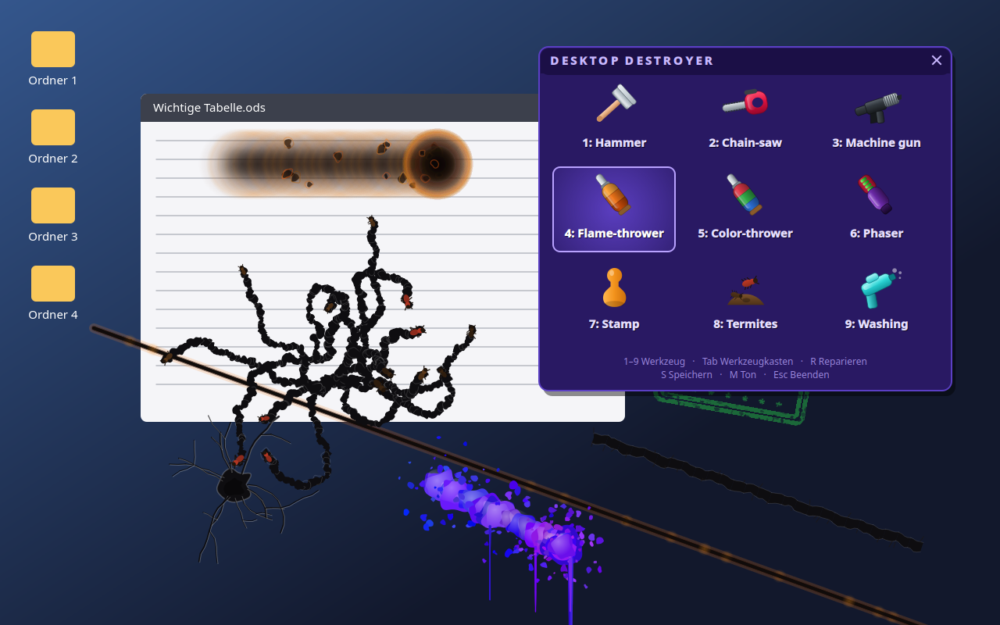

# Desktop Destroyer

<p>
  
  <a href="https://github.com/TechnikWeber/linux-desktop-destroyer/releases/latest"></a>
  <a href="https://github.com/TechnikWeber/linux-desktop-destroyer/actions/workflows/ci.yml"></a>
  
  <a href="LICENSE"></a>
</p>

The 90s classic, now for Linux. Hammer, chain-saw, machine gun, flame-thrower,
colour-thrower, phaser, stamp, termites and washing gun, let loose on your real
desktop.



## How it works

On launch a still of your desktop is captured and shown back pixel-for-pixel as a
fullscreen window. What you tear apart is that image — your windows, your files and
your session are never touched. `Esc` quits, `R` repairs everything.

That is exactly why it behaves identically on **X11 and Wayland**: nothing is drawn
into other applications' windows and nothing is smuggled past the compositor.

## Download

From the [latest release](https://github.com/TechnikWeber/linux-desktop-destroyer/releases/latest):

| File | For |
|---|---|
| `desktop-destroyer-*-x86_64.AppImage` | Any distribution: download, make executable, run. Or open it with [Gear Lever](https://flathub.org/apps/it.mijorus.gearlever), which puts it into the application menu and also updates it. Brings its own Qt, nothing else to install. |
| `desktop-destroyer-*.noarch.rpm` | Fedora: `sudo dnf install ./desktop-destroyer-*.noarch.rpm`. Uses the system Qt; `dnf remove desktop-destroyer` takes it away again. |

Then look for **Desktop Destroyer** in your application menu and click it.

To grab the desktop on Wayland it uses `spectacle` (KDE), `grim` (wlroots),
GNOME Shell or the XDG screenshot portal, whichever is there.

### From the source

```bash
git clone https://github.com/TechnikWeber/linux-desktop-destroyer.git
cd linux-desktop-destroyer
./install.sh
```

`install.sh` adds exactly three things: a menu entry, an icon and a
`desktop-destroyer` command in `~/.local/bin`, all pointing into the cloned
folder, so keep it. `./uninstall.sh` takes them away again. If PySide6 (Qt 6)
is missing, the script offers to build a local `.venv` — your distribution's
package is the tidier option:

| Distribution | Package |
|---|---|
| Fedora / RHEL | `sudo dnf install python3-pyside6` |
| Debian 13+, Ubuntu 26.04+ | `sudo apt install python3-pyside6.qtwidgets python3-pyside6.qtmultimedia python3-pyside6.qtdbus` |
| Arch | `sudo pacman -S pyside6` |

Ubuntu 24.04 and older (and Linux Mint 22 based on it) have no PySide6 package; take
the `.venv` that `install.sh` offers (it needs `sudo apt install python3-venv` first),
or simply the AppImage.

## Controls

| Key                    | Effect                                          |
|------------------------|-------------------------------------------------|
| `1` … `9`              | Pick a weapon                                   |
| Left mouse button      | Strike; hold for continuous fire                |
| Mouse wheel            | Next / previous weapon                          |
| `Tab` or right click   | Show or hide the toolbox                        |
| `R`                    | Repair the whole desktop                        |
| `S`                    | Save the wreckage as a PNG (`~/Pictures`)       |
| `M`                    | Sound on / off                                  |
| `Esc` or `Q`           | Quit                                            |

Drag the toolbox around by its title bar.

## The nine tools

| # | Tool           | What it does                                                       |
|---|----------------|--------------------------------------------------------------------|
| 1 | Hammer         | One dent per click: a crater with branching fractures, screen shakes |
| 2 | Chain-saw      | Dragging cuts one continuous ragged kerf; sawdust flies             |
| 3 | Machine gun    | Continuous fire with spread, bullet holes, muzzle flash and casings |
| 4 | Flame-thrower  | Chars the surface black, paint blisters, smoke drifts up            |
| 5 | Colour-thrower | Splatter in shifting colours, with paint running down               |
| 6 | Phaser         | Burns a glowing slit clean across the screen                        |
| 7 | Stamp          | Presses "DESTROYED", "VOID", "REJECTED" … on, askew and grainy      |
| 8 | Termites       | Releases termites that crawl about and chew tunnels                 |
| 9 | Washing gun    | The undo tool: washes the desktop clean again                       |

## Command line

```
desktop-destroyer [options]

  -w, --windowed       run in a normal window instead of fullscreen (handy for testing)
  -i, --image FILE     destroy an image file instead of the live desktop
  -m, --mute           start muted
  -d, --delay SECONDS  wait before grabbing the desktop
      --primary-only   only take over the primary screen
      --backend        print the detected screenshot backend and exit
```

## Screenshot backends

The still is grabbed with the first method that works on the system:

* **X11** — Qt grabs the root windows directly; otherwise `maim`, `scrot`, `import`
* **Wayland** — `grim` (wlroots: Sway, Hyprland, river, Wayfire), `spectacle` (KDE),
  `org.gnome.Shell.Screenshot`, `gnome-screenshot`
* **anywhere** — `org.freedesktop.portal.Screenshot` as the last resort
  (some compositors ask once before allowing it)

`desktop-destroyer --backend` shows which one was picked. If none of them work the
game still starts — with a painted stand-in desktop.

## Why no image or audio files?

There are none. Every tool icon is vector art in `icons.py`, and all the sounds are
synthesised on first launch in `sfx.py` and cached under `~/.cache/desktop-destroyer/`.
A `git clone` is all it takes.

## License

[MIT](LICENSE).
