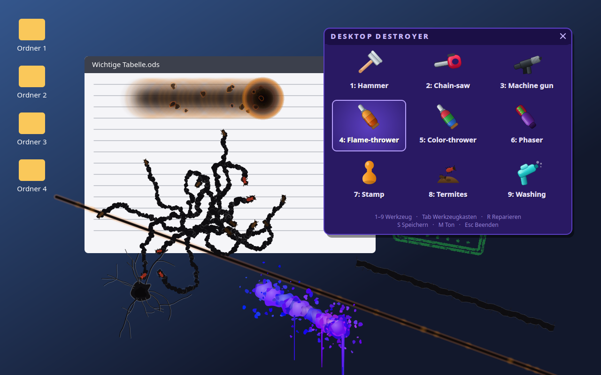

# Desktop Destroyer

Der Klassiker aus den 90ern — jetzt für Linux. Hammer, Kettensäge, Maschinen­gewehr,
Flammenwerfer, Farbwerfer, Phaser, Stempel, Termiten und Waschpistole, losgelassen
auf deinen echten Desktop.



## Wie es funktioniert

Beim Start wird ein Standbild deines Desktops aufgenommen und pixelgenau als
Vollbildfenster wieder angezeigt. Was du danach zerlegst, ist dieses Bild — deine
Fenster, Dateien und Sitzung bleiben unangetastet. `Esc` beendet, `R` repariert
alles wieder.

Genau deshalb läuft es identisch unter **X11 und Wayland**: es wird nichts in
fremde Fenster gezeichnet und nichts am Compositor vorbei manipuliert.

## Installation

Einzige Abhängigkeit ist PySide6 (Qt 6).

```bash
git clone https://github.com/TechnikWeber/desktop-destroyer.git
cd desktop-destroyer
./desktop-destroyer
```

Fehlt PySide6, meldet der Starter das mit dem passenden Paketnamen:

| Distribution  | Paket                                |
|---------------|--------------------------------------|
| Fedora / RHEL | `sudo dnf install python3-pyside6`   |
| Debian/Ubuntu | `sudo apt install python3-pyside6`   |
| Arch          | `sudo pacman -S pyside6`             |
| sonst         | `./install.sh` — legt ein lokales `.venv` an |

Optional ins Anwendungsmenü:

```bash
install -Dm644 desktop-destroyer.desktop ~/.local/share/applications/desktop-destroyer.desktop
ln -sf "$PWD/desktop-destroyer" ~/.local/bin/desktop-destroyer
```

## Steuerung

| Taste            | Wirkung                                        |
|------------------|------------------------------------------------|
| `1` … `9`        | Waffe wählen                                   |
| Linke Maustaste  | zuschlagen, halten für Dauerfeuer              |
| Mausrad          | nächste / vorherige Waffe                      |
| `Tab` / rechte Maustaste | Werkzeugkasten ein- und ausblenden      |
| `R`              | Desktop komplett reparieren                    |
| `S`              | Trümmerfeld als PNG speichern (`~/Bilder`)     |
| `M`              | Ton an / aus                                   |
| `Esc` oder `Q`   | Beenden                                        |

Den Werkzeugkasten kannst du an seiner Titelleiste verschieben.

## Die neun Werkzeuge

| # | Werkzeug        | Wirkung                                                        |
|---|-----------------|----------------------------------------------------------------|
| 1 | Hammer          | Ein Schlag pro Klick: Krater mit verästelten Rissen, Bildschirm wackelt |
| 2 | Kettensäge      | Ziehen schneidet eine durchgehende, ausgefranste Kerbe; Sägemehl fliegt |
| 3 | Maschinengewehr | Dauerfeuer mit Streuung, Einschusslöchern, Mündungsfeuer und Hülsen |
| 4 | Flammenwerfer   | Verkohlt die Oberfläche schwarz, Blasen werfen, Rauch steigt auf |
| 5 | Farbwerfer      | Spritzer in wechselnden Farben, die nach unten verlaufen        |
| 6 | Phaser          | Brennt einen glühenden Schnitt quer über den Bildschirm         |
| 7 | Stempel         | Drückt „KAPUTT", „VOID", „REJECTED" … schräg und krisselig auf  |
| 8 | Termiten        | Setzt Termiten aus, die umherlaufen und Fraßgänge nagen         |
| 9 | Waschpistole    | Das Rückgängig-Werkzeug: wäscht den Desktop wieder sauber       |

## Kommandozeile

```
desktop-destroyer [Optionen]

  -w, --windowed       im normalen Fenster statt im Vollbild (gut zum Testen)
  -i, --image DATEI    ein Bild statt des echten Desktops zerlegen
  -m, --mute           stumm starten
  -d, --delay SEKUNDEN vor der Aufnahme warten
      --primary-only   nur den Hauptbildschirm übernehmen
      --backend        erkanntes Screenshot-Verfahren ausgeben und beenden
```

## Screenshot-Verfahren

Das Standbild wird über die erste Methode geholt, die auf dem System funktioniert:

* **X11** — Qt greift die Root-Fenster direkt ab; sonst `maim`, `scrot`, `import`
* **Wayland** — `grim` (wlroots: Sway, Hyprland, river, Wayfire), `spectacle` (KDE),
  `org.gnome.Shell.Screenshot`, `gnome-screenshot`
* **überall** — `org.freedesktop.portal.Screenshot` als letzter Ausweg
  (kann je nach Compositor einmalig nachfragen)

`desktop-destroyer --backend` zeigt, was gewählt wurde. Klappt nichts davon,
startet das Spiel trotzdem — dann eben mit einem gemalten Ersatz-Desktop.

## Warum keine Grafik- und Audiodateien?

Es gibt keine. Sämtliche Werkzeug-Icons sind Vektor­zeichnungen in
`icons.py`, alle Geräusche werden beim ersten Start in `sfx.py` synthetisiert und
unter `~/.cache/desktop-destroyer/` abgelegt. Ein `git clone` genügt.

## Lizenz

MIT — siehe [LICENSE](LICENSE).
